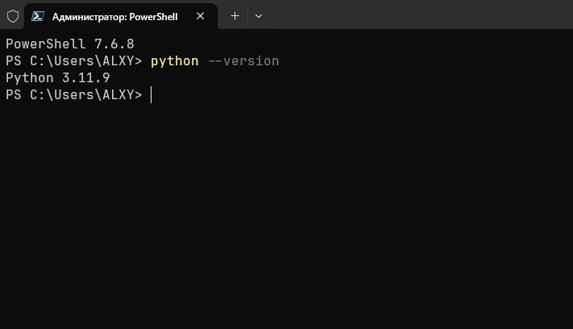
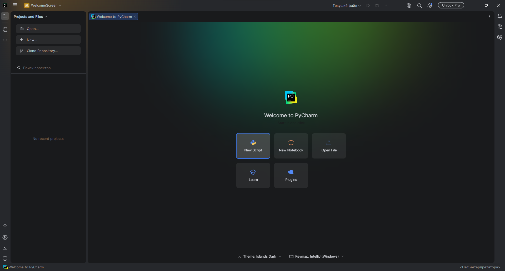
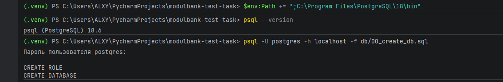
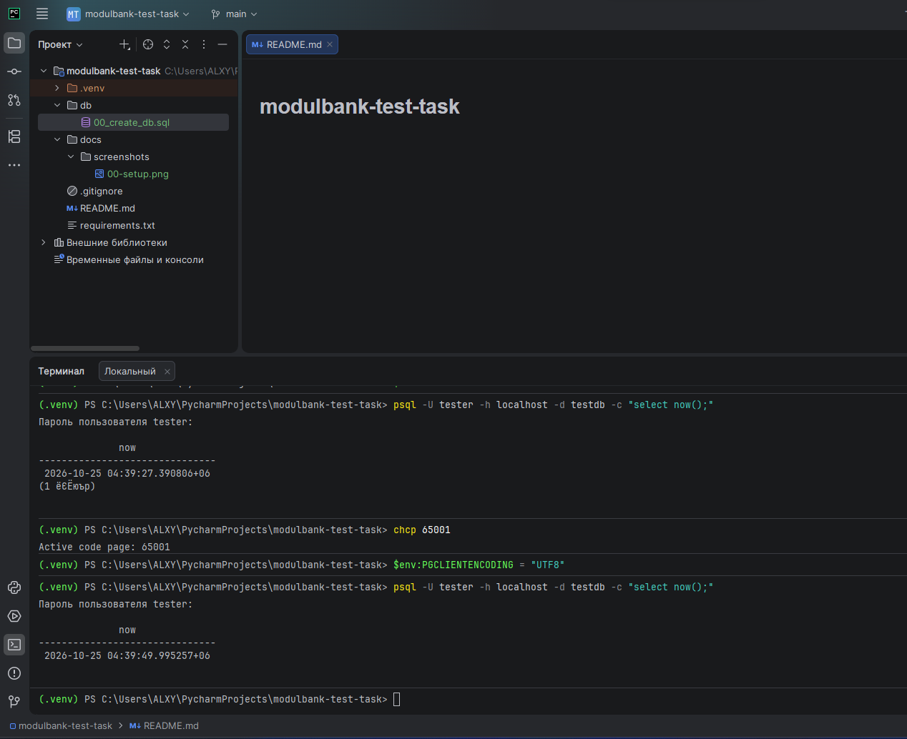
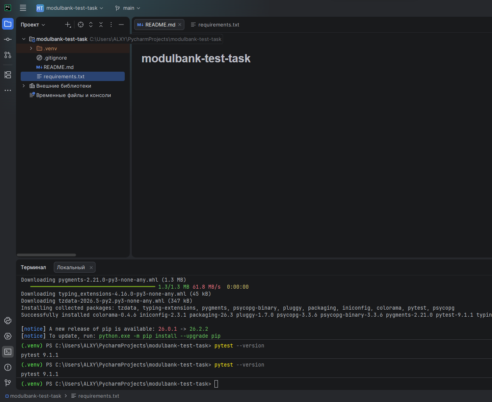
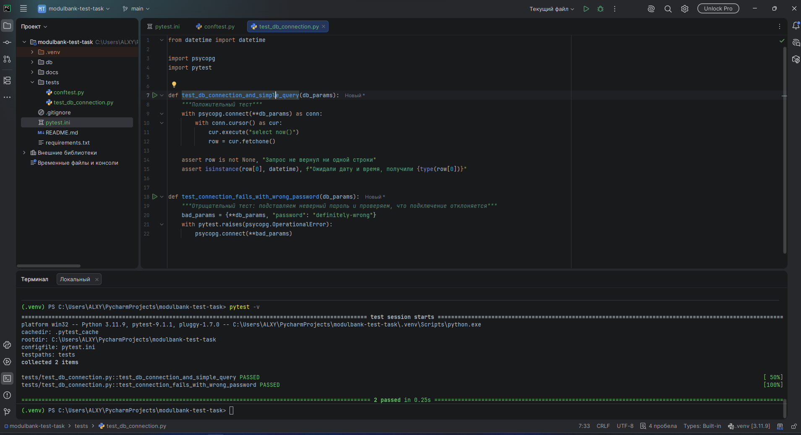
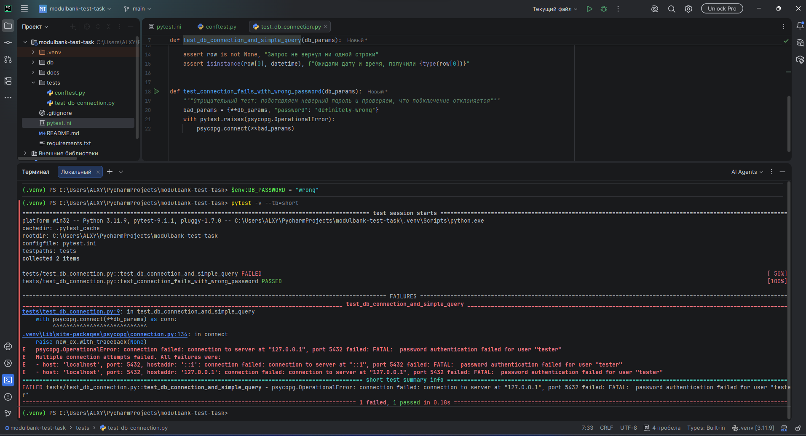

# Тестовое задание: базы данных, SQL и автотест подключения к БД

Выполнение тестового задания «Тестирование стажёров: базы данных и SQL».
Работа сделана по шагам, каждый этап зафиксирован отдельным коммитом и скриншотами.

**Окружение:** Windows, Python 3.11.9, PyCharm, PostgreSQL 18, pytest 9.1.1, psycopg 3.3.6 (`psycopg[binary]`).

---

## Python: автотест подключения к БД

Выбрана СУБД **PostgreSQL** (разрешена условием), драйвер **psycopg 3**, запрос `select now()`.

### Шаг 1. Python 3 и среда разработки

Python 3.11.9 установлен, в PowerShell команда `python --version` отрабатывает. Docker на компьютере не
установлен, поэтому базу ставлю обычным установщиком (условие допускает Docker, но не требует его).



Установлена среда разработки PyCharm. Репозиторий склонирован из GitHub прямо в PyCharm, для проекта
создано виртуальное окружение `.venv` на Python 3.11.



### Шаг 2. Развёртывание СУБД

PostgreSQL установлен с официального сайта (установщик для Windows, параметры по умолчанию, порт 5432).
Дальше создаю отдельного пользователя и базу для тестов. Команды лежат в файле
[`db/00_create_db.sql`](db/00_create_db.sql):

```sql
CREATE ROLE tester LOGIN PASSWORD 'tester_pass';
CREATE DATABASE testdb OWNER tester;
```

Пароль учебный и годится только для локальной тестовой базы. Запуск скрипта от имени суперпользователя:

```powershell
psql -U postgres -h localhost -f db/00_create_db.sql
```



Проверка, что под новым пользователем можно подключиться и выполнить запрос:

```powershell
psql -U tester -h localhost -d testdb -c "select now();"
```



### Шаг 3. Установка pytest и драйвера БД

Зависимости записаны в [`requirements.txt`](requirements.txt):

```
pytest>=8.0
psycopg[binary]>=3.1
```

Установка в виртуальное окружение и проверка:

```powershell
pip install -r requirements.txt
pytest --version
```



### Шаг 4. Тест

Файлы:

- [`pytest.ini`](pytest.ini): говорит pytest, что тесты лежат в папке `tests`;
- [`tests/conftest.py`](tests/conftest.py): фикстура с параметрами подключения;
- [`tests/test_db_connection.py`](tests/test_db_connection.py): сами тесты.

Параметры подключения берутся из переменных окружения (`DB_HOST`, `DB_PORT`, `DB_NAME`, `DB_USER`,
`DB_PASSWORD`), а если переменная не задана, используется значение по умолчанию. Благодаря этому тест
можно запустить с неверным паролем, не меняя код.

```python
# tests/conftest.py
import os

import pytest


@pytest.fixture
def db_params():
    """Параметры подключения: из переменных окружения, иначе значения по умолчанию."""
    return {
        "host": os.getenv("DB_HOST", "localhost"),
        "port": int(os.getenv("DB_PORT", "5432")),
        "dbname": os.getenv("DB_NAME", "testdb"),
        "user": os.getenv("DB_USER", "tester"),
        "password": os.getenv("DB_PASSWORD", "tester_pass"),
    }
```

```python
# tests/test_db_connection.py
from datetime import datetime

import psycopg
import pytest


def test_db_connection_and_simple_query(db_params):
    """Положительный тест"""
    with psycopg.connect(**db_params) as conn:
        with conn.cursor() as cur:
            cur.execute("select now()")
            row = cur.fetchone()

    assert row is not None, "Запрос не вернул ни одной строки"
    assert isinstance(row[0], datetime), f"Ожидали дату и время, получили {type(row[0])}"


def test_connection_fails_with_wrong_password(db_params):
    """Отрицательный тест: подставляем неверный пароль и проверяем, что подключение отклоняется"""
    bad_params = {**db_params, "password": "definitely-wrong"}
    with pytest.raises(psycopg.OperationalError):
        psycopg.connect(**bad_params)
```

Что проверяют тесты:

1. `test_db_connection_and_simple_query` подключается к базе, выполняет `select now()` и убеждается, что
   вернулась ровно одна строка со значением типа «дата и время».
2. `test_connection_fails_with_wrong_password` сам подставляет неверный пароль и проверяет, что сервер
   отклоняет подключение (`psycopg.OperationalError`). Так проверяется и негативный сценарий.

### Шаг 5. Демонстрация работоспособности

**Успешный прогон.** Команда `pytest -v`: оба теста `PASSED`, итог `2 passed`.

```powershell
pytest -v
```



**Падение при неверных параметрах.** Подменяю пароль через переменную окружения, запускаю тесты и после
этого возвращаю настройки:

```powershell
$env:DB_PASSWORD = "wrong"
pytest -v --tb=short
Remove-Item Env:DB_PASSWORD
```



Результат `1 failed, 1 passed`:

- `test_db_connection_and_simple_query` упал с `psycopg.OperationalError: ... FATAL: password authentication
  failed for user "tester"`. Это и есть ожидаемое падение теста при неверных параметрах подключения;
- `test_connection_fails_with_wrong_password` прошёл: он сам использует неверный пароль и как раз проверяет,
  что база такое подключение отклоняет.

### Заметки по Windows

- **Кодировка в psql.** Русскоязычный вывод psql в терминале PyCharm может отображаться «кракозябрами».
  Помогает `chcp 65001` и `$env:PGCLIENTENCODING = "UTF8"`. На работу тестов это не влияет.
- **Сообщения сервера об ошибке.** При отказе в аутентификации русскоязычный сервер присылает текст в
  кодировке Windows-1251, и psycopg показывает его как «�����». Чтобы ошибки были читаемыми (в том числе на
  скриншотах), я переключил сообщения сервера на английский (команда выполнена от имени `postgres`):

  ```powershell
  psql -U postgres -h localhost -c "ALTER SYSTEM SET lc_messages = 'C';" -c "SELECT pg_reload_conf();"
  ```

## Как запустить у себя

1. Установить Python 3 и PostgreSQL, добавить `...\PostgreSQL\<версия>\bin` в `PATH`.
2. Создать роль и базу: `psql -U postgres -h localhost -f db/00_create_db.sql`.
3. Создать окружение и поставить зависимости:

   ```powershell
   python -m venv .venv
   .venv\Scripts\Activate.ps1
   pip install -r requirements.txt
   ```

4. Запустить тесты: `pytest -v` (ожидаемо `2 passed`).

Если PostgreSQL слушает не на `localhost:5432`, параметры можно задать переменными окружения
(`DB_HOST`, `DB_PORT`, `DB_NAME`, `DB_USER`, `DB_PASSWORD`).

## Структура репозитория

```
.
├── db/
│   └── 00_create_db.sql       # создание роли и базы
├── docs/screenshots/          # скриншоты для отчёта
├── tests/
│   ├── conftest.py            # параметры подключения (фикстура)
│   └── test_db_connection.py  # автотесты подключения к БД
├── pytest.ini
├── requirements.txt
└── README.md
```

