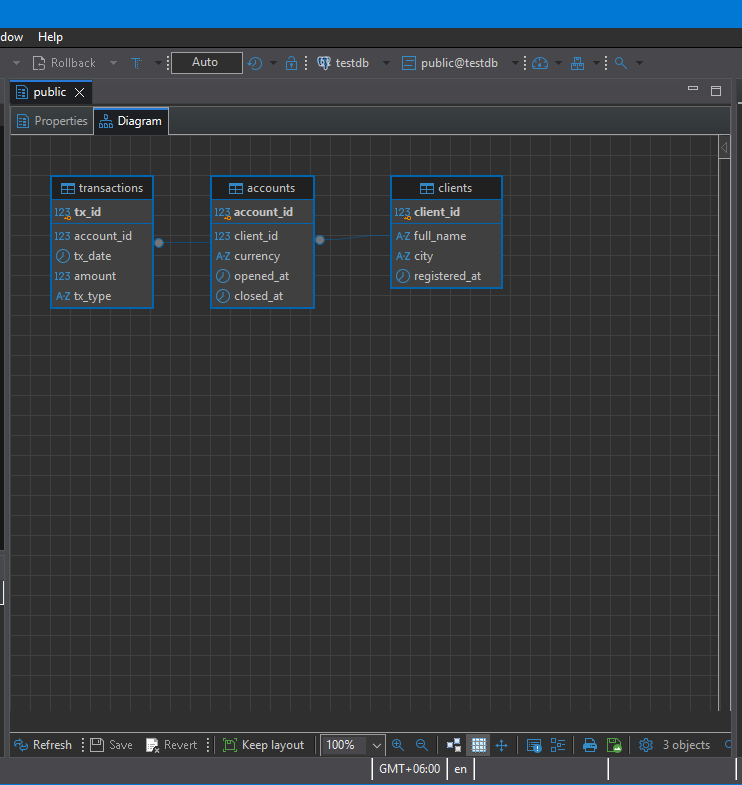
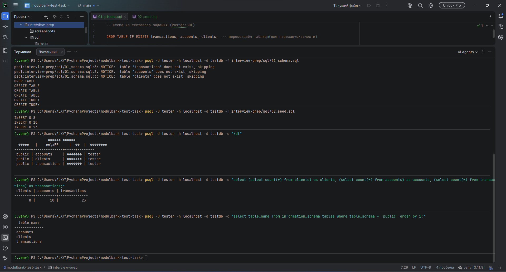
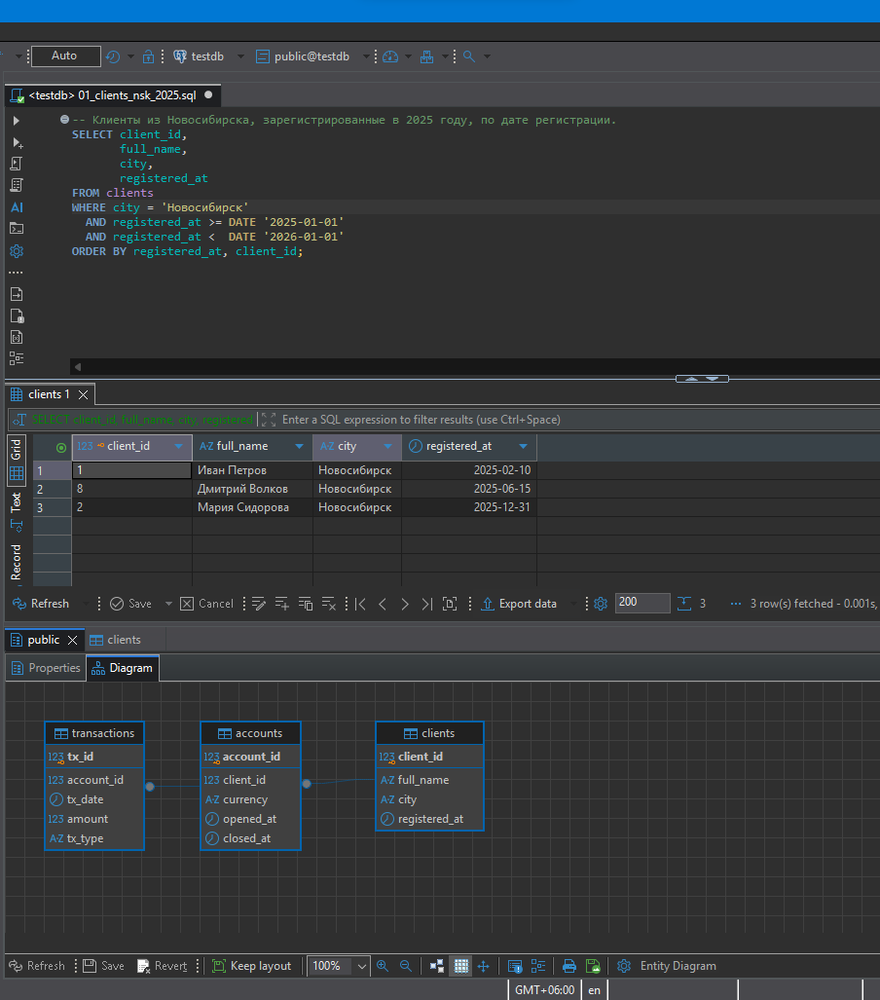
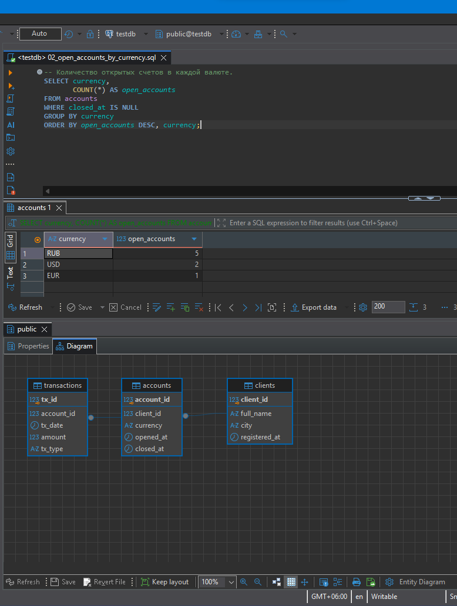
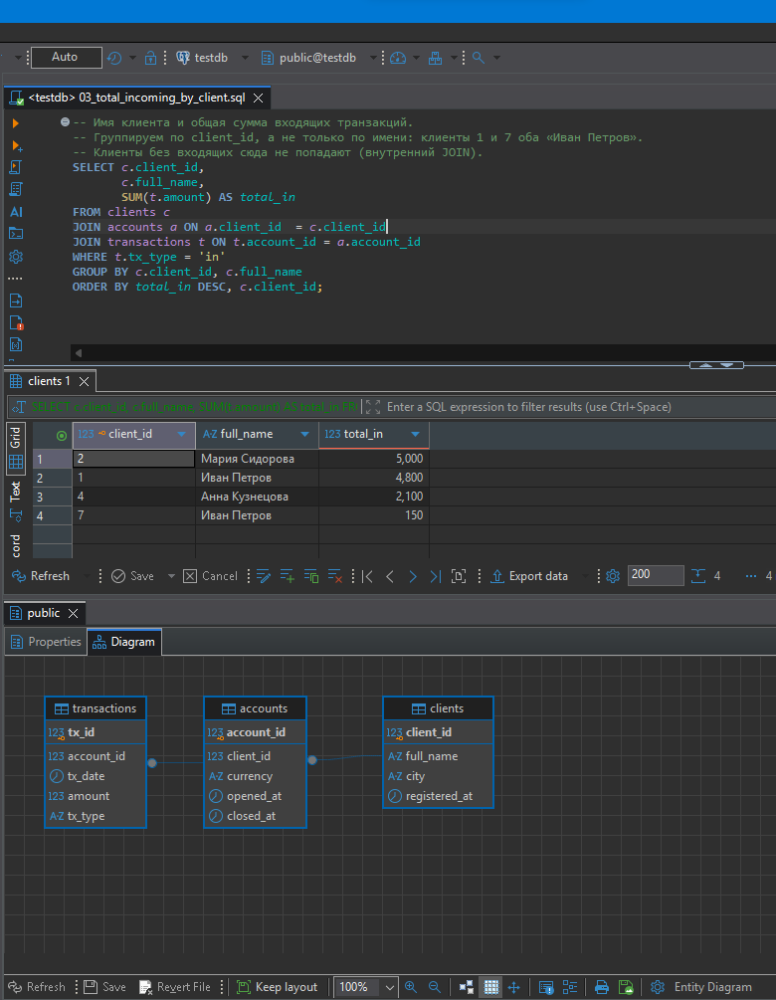
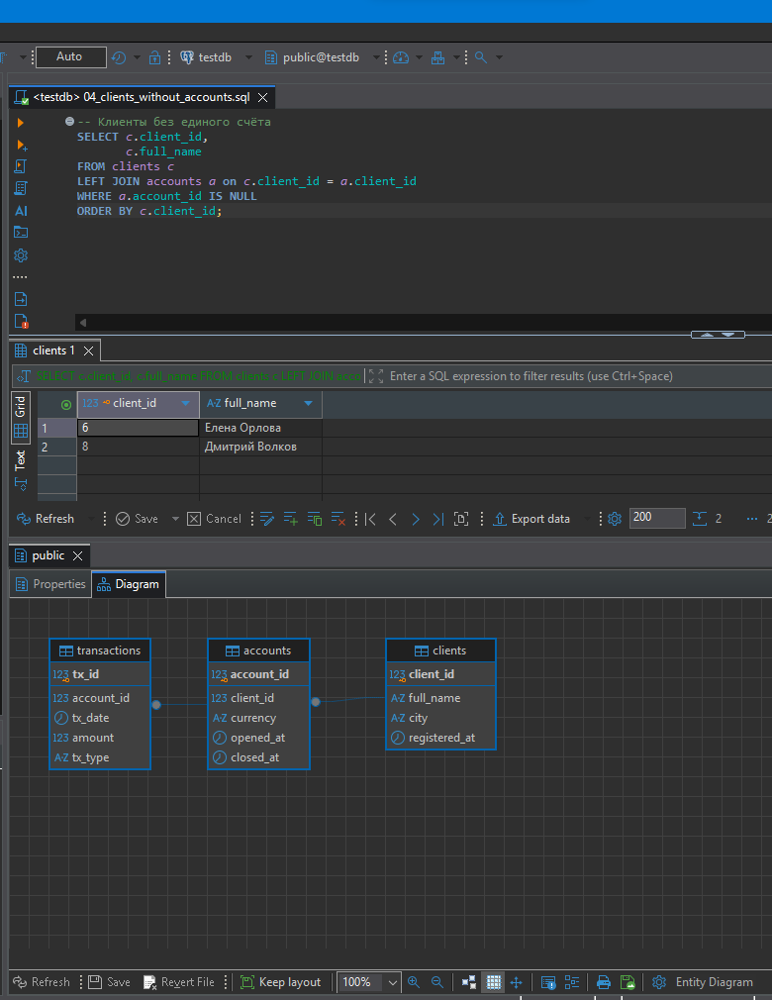
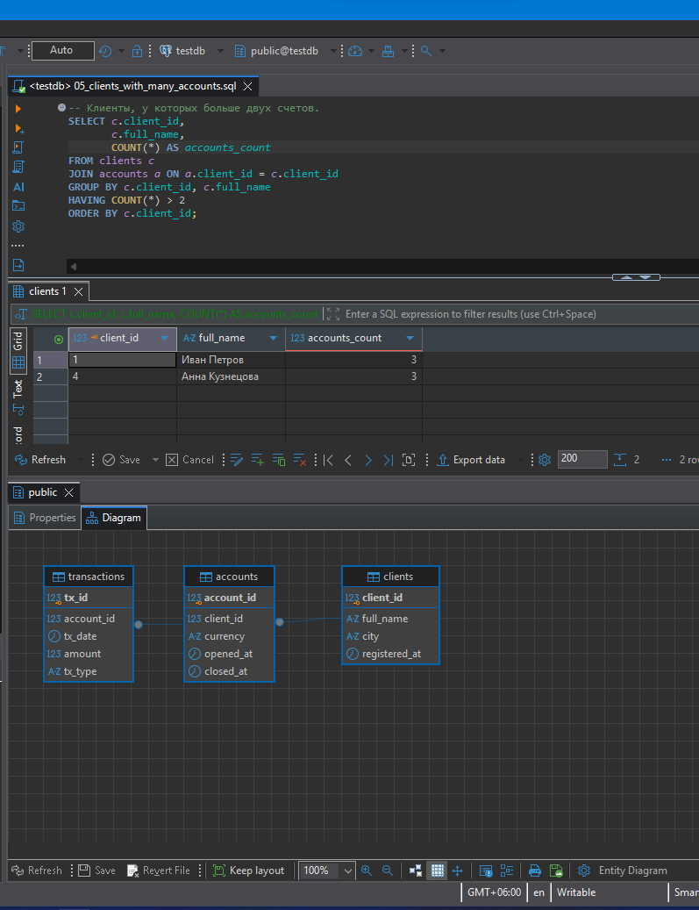
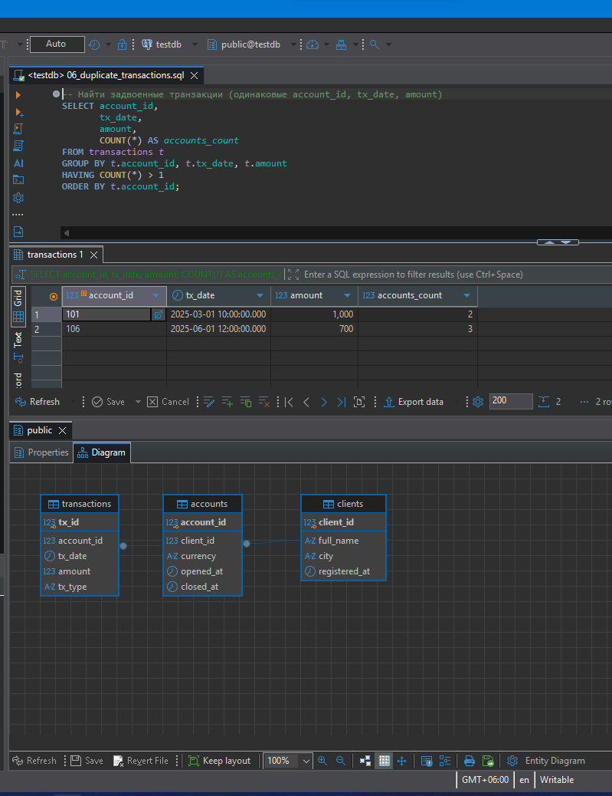
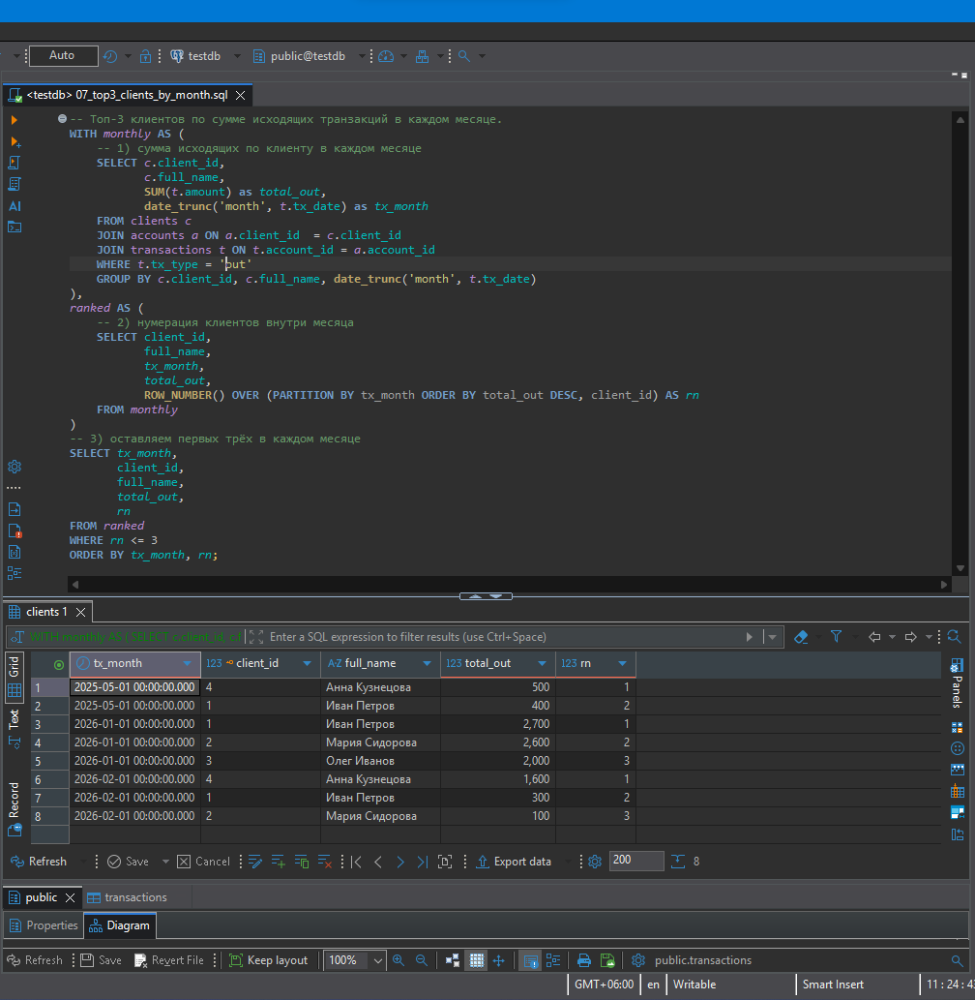

# Подготовка к интервью: SQL-задачи

Дополнительная работа сверх тестового задания. Здесь решены SQL-задачи 1–7 из «Части 2» задания
(СУБД: PostgreSQL). Каждая задача лежит в отдельном файле, рядом есть скриншот результата.

| № | Задача | Решение | Что демонстрирует |
|---|---|---|---|
| 1 | Клиенты из Новосибирска, зарегистрированные в 2025 году | [`01_clients_nsk_2025.sql`](sql/tasks/01_clients_nsk_2025.sql) | `WHERE`, диапазон дат, `ORDER BY` |
| 2 | Количество открытых счетов в каждой валюте | [`02_open_accounts_by_currency.sql`](sql/tasks/02_open_accounts_by_currency.sql) | `IS NULL`, `GROUP BY`, `COUNT` |
| 3 | Имя клиента и общая сумма входящих транзакций | [`03_total_incoming_by_client.sql`](sql/tasks/03_total_incoming_by_client.sql) | `JOIN` трёх таблиц, `SUM`, группировка по ключу |
| 4 | Клиенты без единого счёта | [`04_clients_without_accounts.sql`](sql/tasks/04_clients_without_accounts.sql) | анти-джойн (`LEFT JOIN ... IS NULL`) |
| 5 | Клиенты, у которых больше двух счетов | [`05_clients_with_many_accounts.sql`](sql/tasks/05_clients_with_many_accounts.sql) | `HAVING` |
| 6 | Задвоенные транзакции | [`06_duplicate_transactions.sql`](sql/tasks/06_duplicate_transactions.sql) | группировка по нескольким столбцам, `HAVING COUNT(*) > 1` |
| 7 | Топ-3 клиентов по сумме исходящих в каждом месяце | [`07_top3_clients_by_month.sql`](sql/tasks/07_top3_clients_by_month.sql) | CTE, оконная функция `ROW_NUMBER()` |

## Схема и данные

Схема из условия задания: три таблицы со связями «клиент → счета → транзакции».



| Таблица | Столбцы |
|---|---|
| `clients` | `client_id` (PK), `full_name`, `city`, `registered_at` |
| `accounts` | `account_id` (PK), `client_id` (FK), `currency`, `opened_at`, `closed_at` (`NULL` = счёт открыт) |
| `transactions` | `tx_id` (PK), `account_id` (FK), `tx_date`, `amount`, `tx_type` (`'in'` / `'out'`) |

Файлы: [`sql/01_schema.sql`](sql/01_schema.sql) (таблицы и индексы по внешним ключам) и
[`sql/02_seed.sql`](sql/02_seed.sql) (тестовые данные: 8 клиентов, 10 счетов, 23 транзакции).

Данные подобраны так, чтобы были видны подводные камни задач:

- граничные даты регистрации (31.12.2024, 31.12.2025, 01.01.2026);
- два разных клиента с одинаковым именем «Иван Петров», поэтому группировать надо по `client_id`, а не по имени;
- клиенты без счетов и счёт без транзакций;
- закрытые счета;
- дубли транзакций;
- ничья за третье место в январе 2026.

Загрузка (скрипт `01_schema.sql` начинается с `DROP TABLE IF EXISTS`, поэтому его можно запускать повторно,
но таблицы при этом пересоздаются с нуля):

```powershell
psql -U tester -h localhost -d testdb -f interview-prep/sql/01_schema.sql
psql -U tester -h localhost -d testdb -f interview-prep/sql/02_seed.sql
```

Проверка загрузки:



## Решения

### 1. Клиенты из Новосибирска, зарегистрированные в 2025 году

Условие по городу и по году в `WHERE`. Год задан диапазоном «начало 2025 включительно, начало 2026 не
включительно», чтобы не потерять 31.12.2025 и не захватить 01.01.2026. Результат: клиенты 1, 8 и 2 по дате
регистрации.



### 2. Количество открытых счетов в каждой валюте

Открытый счёт — тот, у которого `closed_at IS NULL`. Фильтр стоит в `WHERE` (до группировки), затем
`GROUP BY currency` и `COUNT(*)`. Результат: RUB — 5, USD — 2, EUR — 1; закрытые счета не учитываются.



### 3. Имя клиента и общая сумма входящих транзакций

Цепочка `clients → accounts → transactions`, фильтр `tx_type = 'in'`, `SUM(amount)`. Группировка идёт по
`client_id` (и имени), поэтому два клиента по имени «Иван Петров» не сливаются в одну строку.
Результат: четыре клиента, у кого есть входящие.



### 4. Клиенты без единого счёта

`LEFT JOIN` счетов к клиентам и отбор строк, где справа ничего не нашлось (`account_id IS NULL`). Результат:
клиенты 6 (Елена Орлова) и 8 (Дмитрий Волков).



### 5. Клиенты, у которых больше двух счетов

Группировка по клиенту и условие `HAVING COUNT(*) > 2`: условие на агрегат нельзя поставить в `WHERE`.
Результат: клиенты 1 и 4, у каждого по три счёта (закрытые тоже учитываются).



### 6. Задвоенные транзакции

Группировка по тройке `account_id`, `tx_date`, `amount` и `HAVING COUNT(*) > 1`. Идентификатор `tx_id` в
группировку не входит, иначе дублей бы не нашлось. Результат: две группы дублей (счёт 101 — 2 повтора,
счёт 106 — 3 повтора).



### 7. Топ-3 клиентов по сумме исходящих в каждом месяце

Первая CTE считает сумму исходящих по клиенту и месяцу (`date_trunc('month', ...)`). Вторая нумерует клиентов
внутри месяца функцией `ROW_NUMBER() OVER (PARTITION BY месяц ORDER BY сумма DESC, client_id)`. Финальный
запрос оставляет номера не выше 3: фильтровать по результату оконной функции можно только на следующем уровне
запроса. В январе 2026 у клиентов 3 и 4 одинаковая сумма 2000, поэтому за третье место при `ROW_NUMBER`
побеждает клиент с меньшим `client_id`. Если нужно показать обоих, подойдёт `RANK()`.



## Как запустить

1. Поднять PostgreSQL и создать базу, как описано в [основном отчёте](../README.md) (роль `tester`, база `testdb`).
2. Загрузить схему и данные командами выше.
3. Открыть файл с запросом, например в DBeaver (File → Open File, активное подключение `testdb`, выполнение
   запроса — `Ctrl+Enter`), либо запустить из консоли:

   ```powershell
   psql -U tester -h localhost -d testdb -f interview-prep/sql/tasks/01_clients_nsk_2025.sql
   ```

## Заметки

- Запросы написаны на PostgreSQL. Из специфичного для него используется `date_trunc` (в Oracle аналог —
  `TRUNC(tx_date, 'MM')`); остальной SQL стандартный.
